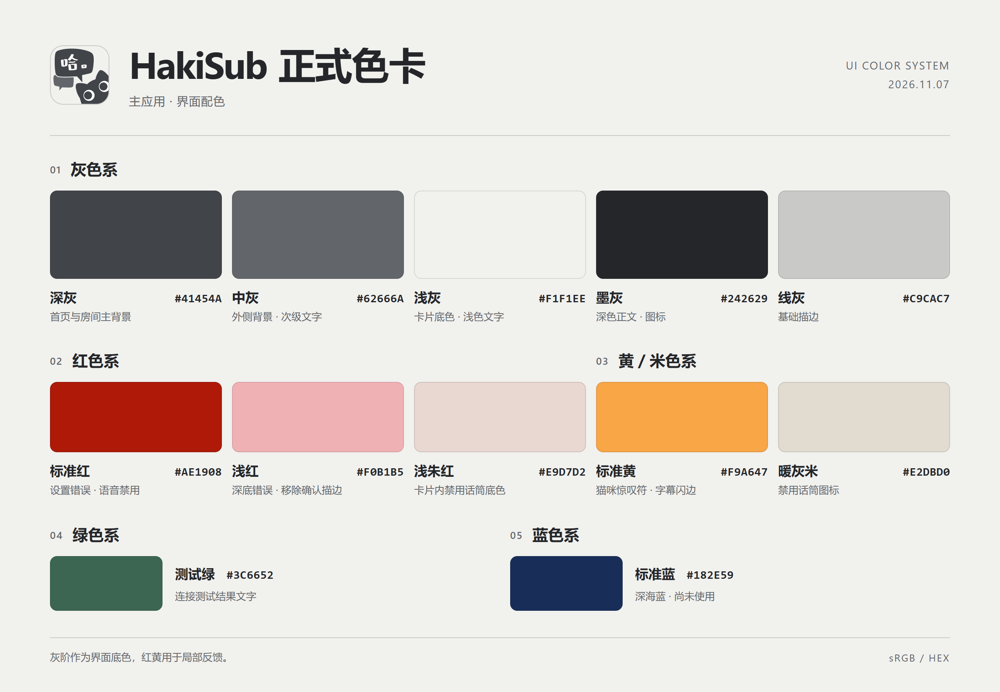

# HakiSub UI 色卡

## 正式色卡

| 色系 | 色值 | 用途 |
| --- | --- | --- |
| 灰色系 | `#41454A` | 首页与房间主背景 |
| 灰色系 | `#62666A` | 外侧背景与次级文字 |
| 灰色系 | `#F1F1EE` | 字幕卡片与浅色文字 |
| 灰色系 | `#242629` | 深色正文与图标 |
| 灰色系 | `#C9CAC7` | 基础描边 |
| 红色系 | `#AE1908` | 标准红，设置错误与语音禁用 |
| 红色系 | `#F0B1B5` | 深底错误文字与移除密钥确认框描边 |
| 红色系 | `#E9D7D2` | 字幕卡片内的禁用话筒底色 |
| 黄／米色系 | `#F9A647` | 标准黄，猫咪惊叹符与字幕入场闪边 |
| 黄／米色系 | `#E2DBD0` | 朱红底上的禁用话筒图标 |
| 绿色系 | `#3C6652` | 房间设置中连接测试结果的文字 |
| 蓝色系 | `#182E59` | 标准蓝（深海蓝），尚未用于界面 |

外侧背景和次级文字共享 `--ui-secondary-gray`，分别通过 `--home-outer-bg` 和 `--home-secondary-text` 使用。

## 原始参考色

2026-11-07 从用户提供的三张色卡记录。项目现有标准灰及其主题变量继续沿用。这组参考色只用于局部点缀，例如图标、暗纹或描边。名称为便于讨论的暂称。

| 暂称 | 网页用 HEX | RGB | 图中 CMYK | 来源 |
| --- | --- | --- | --- | --- |
| 深海蓝 | `#182E59` | `24, 46, 89` | `99, 93, 48, 17` | 图 1 |
| 杏橙 | `#F9A647` | `249, 166, 71` | 未标注 | 图 2 左 |
| 暖灰米 | `#E2DBD0` | `226, 219, 208` | 未标注 | 图 2 右 |
| 朱红 | `#AE1908`（按 RGB 换算） | `174, 25, 8` | `39, 100, 100, 5` | 图 3 |

图 3 印着 `#F9A647`，与图 2 的杏橙相同，但和图 3 的红色色块及 RGB 不一致。原标注留档，网页试色暂按图 3 的 RGB 使用 `#AE1908`。CMYK 仅转录图中文字。

主应用把朱红 `#AE1908` 定为标准红，用于语音禁用主色及房间／模拟设置的错误文字。杏橙 `#F9A647` 定为标准黄，用于猫咪按压惊叹符和新字幕入场闪边。深底错误文字与移除密钥确认框描边共用浅红 `#F0B1B5`。
